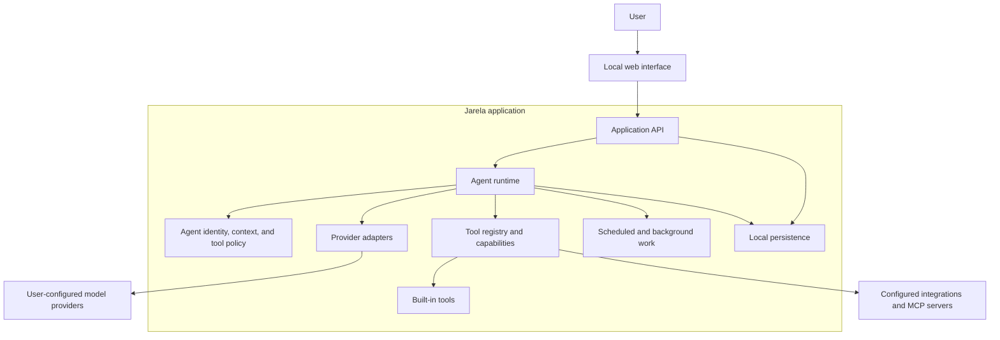

# Jarela

Jarela is a local-first workspace for running and extending LangGraph agents. It
brings a conversation interface, agent orchestration, tools, integrations, and
local persistence together in an application you run on your own machine. No
hosted Jarela backend is required.

Local-first describes where the application and its state run; it does not mean
all model processing is local. Requests may be sent to model providers or
integrations that the user configures.

> **New to Jarela?** Start with the [installation guide](docs/INSTALL.md) and
> [first-run guide](docs/FIRST_RUN.md). The [documentation site](https://circuitwall.github.io/jarela/)
> collects user, operations, architecture, and development guides.

## Architecture at a glance

The main architectural boundaries are:

- **Application interface:** the UI communicates with the application through
  its API rather than reaching into persistence or provider implementations.
- **Agent runtime:** orchestration combines agent instructions, conversation
  context, tool policy, and model-provider calls.
- **Adapters and registries:** providers, tools, MCP servers, and integrations
  connect through explicit extension points.
- **Local persistence:** application-owned state is managed locally, including
  SQLite-backed records and files.
- **Explicit capabilities:** agent tool permissions and user-configured
  connections govern access to tools and external services.

For component relationships, module ownership, and current implementation
details, see the [architecture guide](docs/ARCHITECTURE.md).

## Use and develop

- [Install Jarela](docs/INSTALL.md)
- [Set up a first assistant](docs/FIRST_RUN.md)
- [Operate Jarela](docs/OPERATIONS.md)
- [Understand the architecture](docs/ARCHITECTURE.md)
- [Extend Jarela](docs/EXTENDING.md)
- [Develop and test the project](docs/DEVELOPMENT.md)
- [Read release notes](CHANGELOG.md)
- [Contribute](CONTRIBUTING.md)

The guides are the source for current setup steps, supported capabilities, and
operational details. The changelog records release-specific changes.

## License

Apache-2.0
