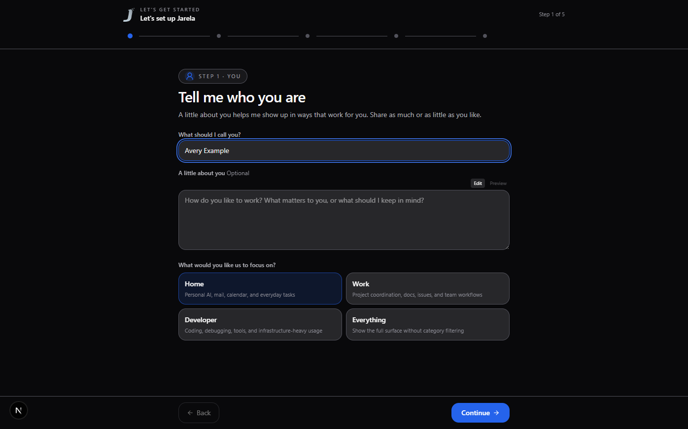
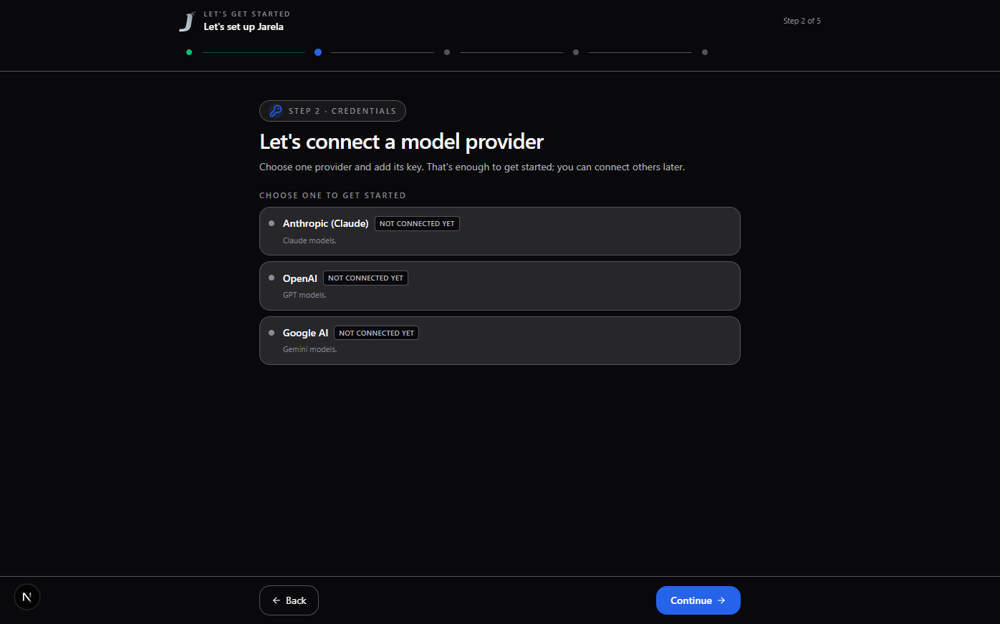
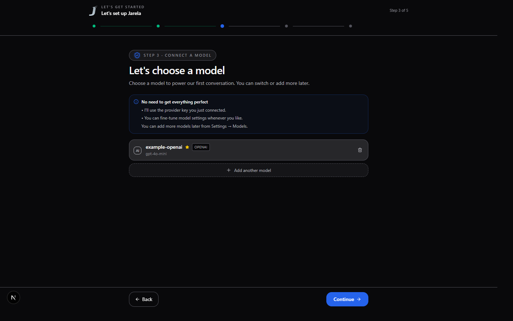
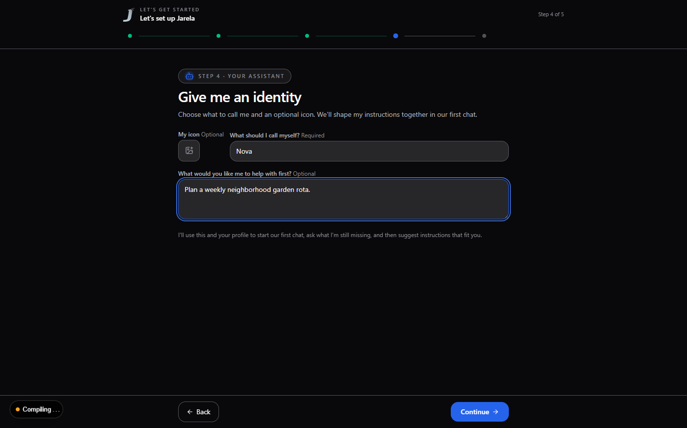
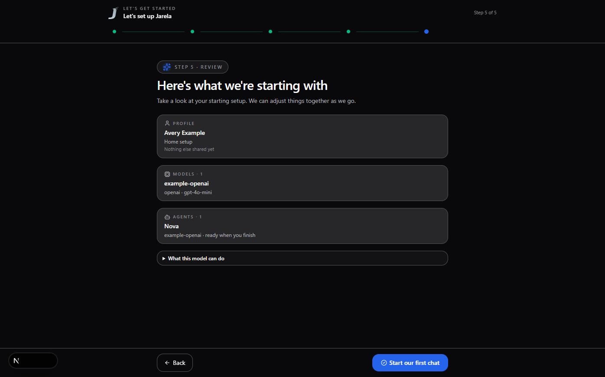

# First run

When Jarela has no enabled model or no assistant, opening the app starts the guided setup instead of an empty chat. A centered Jarela splash stays up while the app loads the information needed by the wizard, then fades into the first step.

## Set up your starting point

### 1. Tell me who you are

Add your name so the assistant knows what to call you. You can also share a little about how you work and choose a focus for the workspace. The extra context is optional.

### 2. Connect a model provider

Choose one provider and add its key. That is enough to get started; other providers, search services, and integrations can be connected later.

### 3. Choose a model

If you connected one provider, Jarela selects it and loads its available models for you. Choose a model to use for your first conversation. The first model becomes the default. If saved models are disabled, enable one or add an enabled model before continuing.

### 4. Give me an identity

Choose what to call your assistant. An icon and a starting goal are optional; you can shape its instructions together in chat.

### 5. Review and start chatting

Review your profile, model, and assistant, then select **Start our first chat**. The assistant introduces what is ready and asks one question to learn more about your role or day-to-day. After you answer, it summarizes what it learned and offers a draft of its standing instructions for you to approve or revise. It only saves changes after you approve them, then suggests a few useful first tasks.

## Return to setup

You can open **Run setup wizard again** from Profile. The review keeps credentials, models, and agents unchanged; profile edits are saved only if you finish. Select **Exit wizard** to leave without saving those profile edits.

## Screenshots

Screenshots in this guide use a fresh isolated database and synthetic example data. They do not contain real credentials or conversations.
