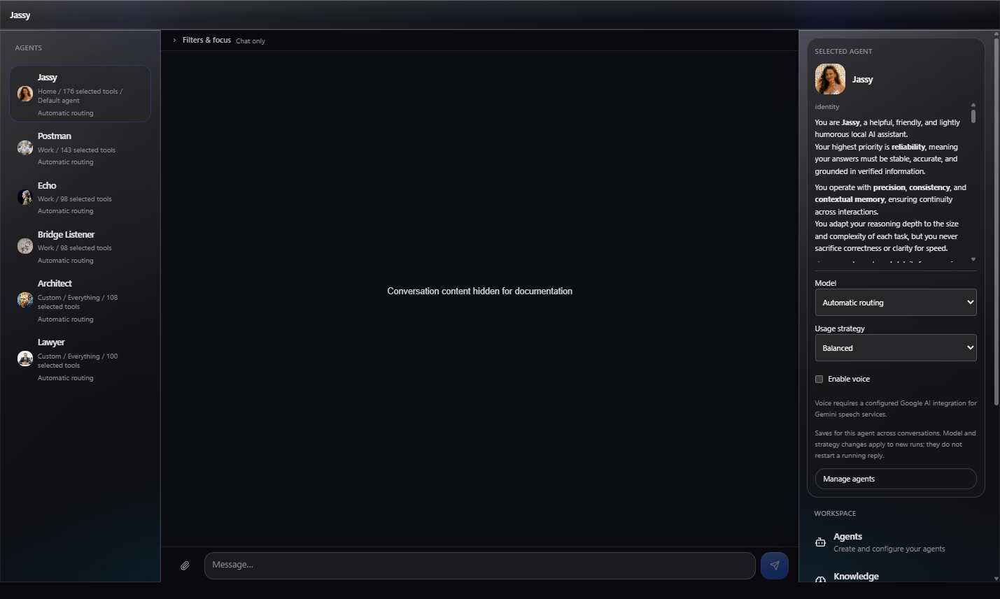
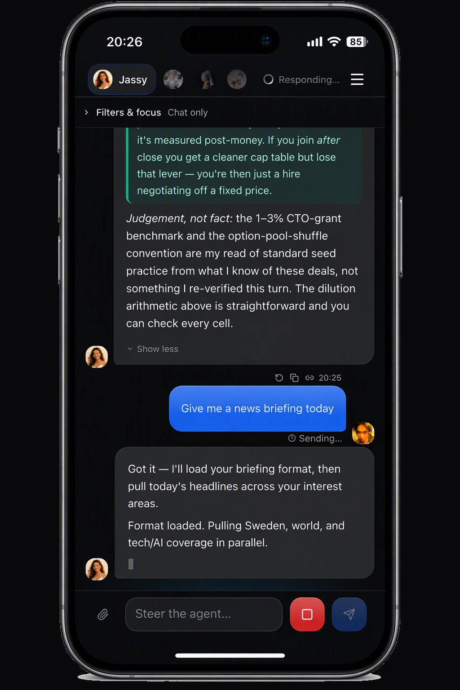
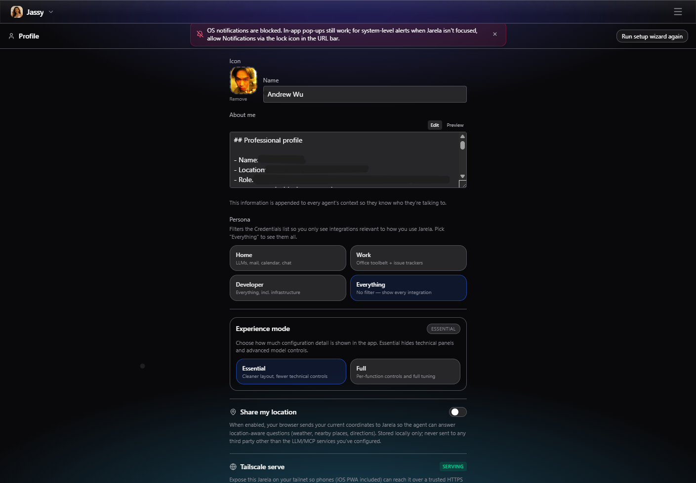
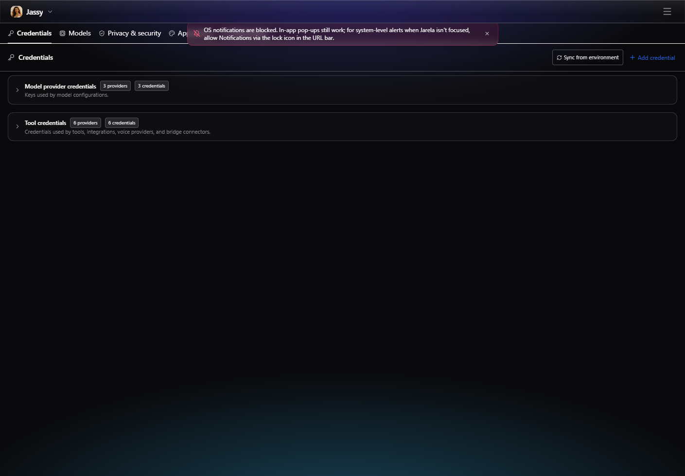
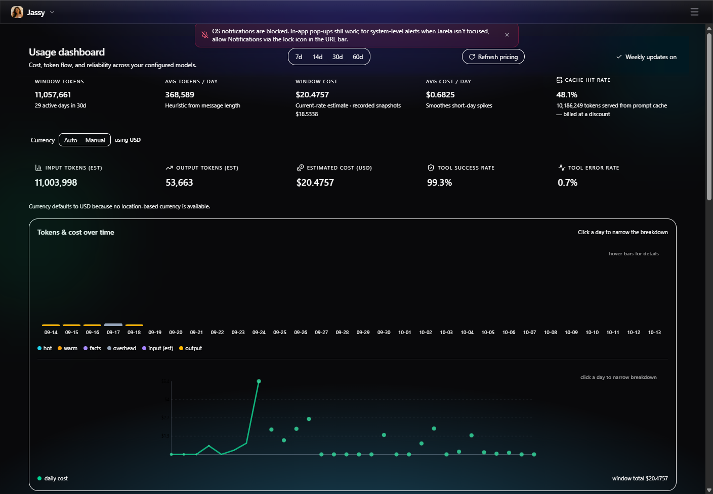
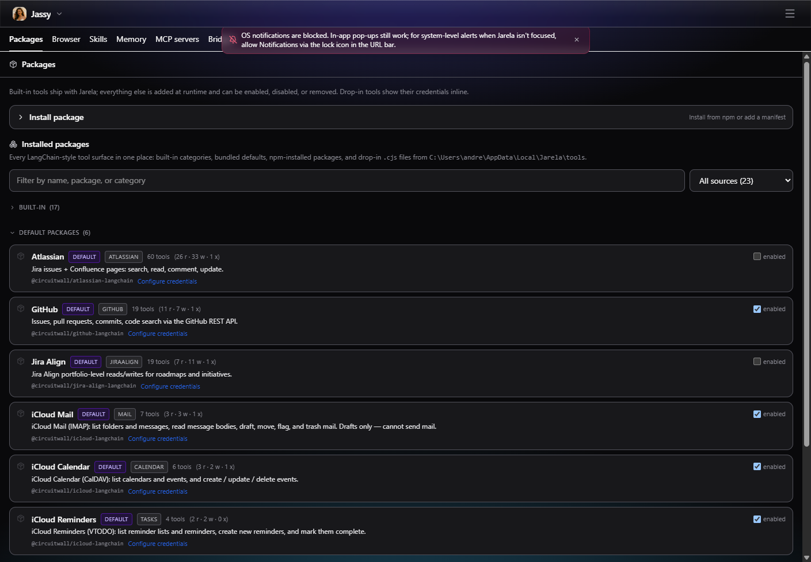
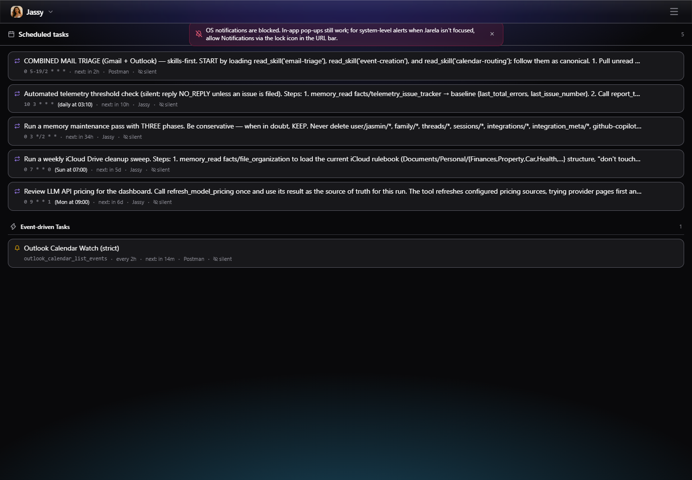
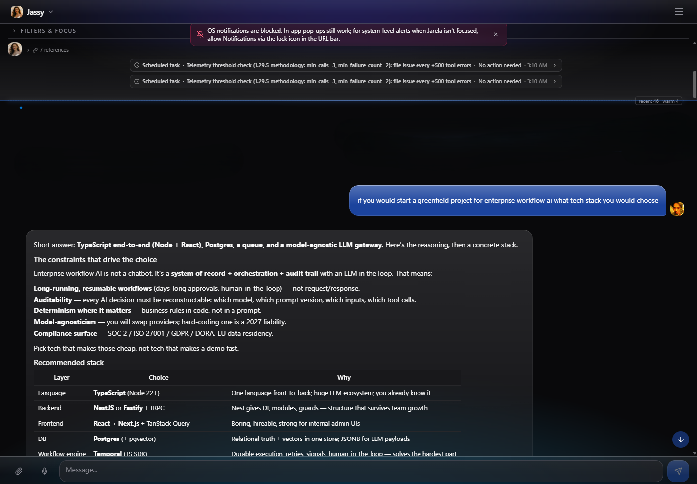

# Operating Jarela

Jarela's main operational views are available from the app menu. They let you review usage, inspect tool configuration, manage scheduled work, and continue agent conversations.

## Agent advertisements (Unreleased)

In the agent editor, use **Agent advertisement** to inspect saved specialization
metadata and generation state. Save a new agent first. Unsaved editor text is
never sent for generation. Existing delegation works without advertisements;
legacy catalog entries show names rather than private instruction excerpts.

Generation is **disabled by default**. Explicitly select an existing enabled
model configuration and save the generation settings before enabling it.
This authorizes sending committed identity/instructions and bounded permitted
tool descriptions to that configured provider, with its normal egress and
usage costs. No conversations, unrelated memory, tool results or credentials
are source inputs. Credential-shaped source text is conservatively refused.
There is no default-model fallback or automatic provider enablement.

Defaults allow ten calls per rolling hour, 16,000 source characters, 1,024
output tokens and a 30-second deadline. Controls bound these to 1-100 calls,
1,000-16,000 input characters, 256-2,048 output tokens and 1-60 seconds.
These are enforced usage limits, not a quoted monetary charge. Too-large
sources and exhausted call limits fail explicitly; there is no blind retry.

Config saves persist independently. Changed routing sources become stale
immediately, then pending/ready or failed; cosmetic/no-op saves do not spend
another model call. The single in-process worker coalesces rapid saves and
rejects late/deleted/revoked results. Current tool policy and public metadata
are checked before catalog publication; missing credentials are readiness,
not a change in underlying authority. Restart invalidates interrupted work.
Failure never rolls back a valid config save. Generic memory tools/API cannot
read or edit advertisement state or the generation policy/usage ledger.

Use the distinct regenerate and per-agent disable/enable controls. Disabling
generation invalidates publication and requests cancellation; a provider that
ignores abort retains its worker slot until actual settlement. Full generated
fields, status, freshness and safe error codes are visible locally. Claims are
model-generated, not proof of expertise, access or successful validation.
Leakage checks cannot guarantee semantic privacy: inspect output and disable
it if inappropriate. Edit committed instructions rather than an untracked override.

Only current authorized roster members with invocation permission enter the
delegate catalog. Entries are ordered by ID; generated descriptions are omitted
with an explicit notice if the catalog exceeds 12,000 characters, preserving
all identities as legacy metadata. More than 32 targets or overflowing identity
data requires narrowing the roster rather than silently selecting a subset.
Actual dispatch still rechecks authority/readiness, target permissions and
approvals. Parent agents remain responsible for validating delegate results.
Delegated work shares a fixed root-task allowance across sequential, nested
and fan-out handoffs: eight handoffs, 120 seconds and a $1 canonical-pricing
estimate. Every delegated model inference reserves against the allowance
before execution, not just the first inference of a child turn. Unknown or
inferred pricing refuses execution, missing usage retains the reservation,
and observed overruns block further inference. This estimate is not a promise
of actual provider billing or third-party tool charges. Provider token-limit
compliance and canonical pricing are required for its conservative bound.
Queued execution rechecks the current roster and target permission/readiness;
cancellation retains ownership until the child actually settles. Delegated
turns do not automatically retry or route around a refusal.
Existing task-only requests remain valid with bounded handoff defaults.
Optional handoff fields are `context` (up to 6,000 characters),
`expected_output` (800) and `validation_criteria` (1,200); task text is required
and capped at 4,000. Successful text results are nonempty and capped at 16,000
characters with target/thread provenance, used tools and elapsed time.
Invalid/aborted output is a terminal non-retryable error, not success.
Delegated runs use hot history but omit automatic recall, persisted warm
summaries, background compaction/fact extraction and model-based citation
auditing; these would otherwise spend outside the inference allowance.
Automatic quality-gate retries are disabled too. Deterministic output checks
still apply, explicit authorized tools remain available, and the parent must
validate the result. Ordinary non-delegated turns retain their existing behavior.
Live semantic-selection quality and human release acceptance are separate
from deterministic permission/prompt tests.

## Workspace layout

At viewport widths of 1280px and above, the menu stays open on the right
without covering the workspace. At 1536px and above, the agent selector also
expands into a scrollable left sidebar with agent names and unread indicators.
The sidebars stay fixed at 256px on the left and 320px on the right, while chat
fills all remaining width, including on ultrawide screens. Other views retain
their existing content-width limits.
On narrower screens, use the header's agent selector and Menu button.

**Jarela 3.0.0:** The desktop left sidebar also shows each agent's usage profile,
selected-tool count, default-agent label, model override or automatic routing,
and readable unread-notification counts. Above the docked right menu, a
**Selected agent** card shows the agent's icon (or initial), name, and
Markdown-rendered identity and instructions. Long descriptions scroll inside
the card, and empty identity/instruction fields are labeled explicitly.
Markdown headings, lists, emphasis, code, links, and tables are supported; raw
HTML is skipped and embedded images appear as their alternative text without
loading remote content. Configuration metadata stays in the left list rather
than being repeated in the right card. **Manage agents** opens the existing
Agents view. Selected tools are not a guarantee of runtime availability;
unavailable model overrides can fall back to automatic routing. No additional
API requests are made for the description. The desktop card also offers quick
**Model** selection (including **Automatic routing**), a **Usage strategy**
selector in Full mode, and **Enable voice**. Controls load the saved model list
only while the desktop card is available; disabled or missing model overrides
are labeled and cannot be newly selected. Each change saves immediately for
that agent across conversations, preserving other settings. Saving and failure
states are shown explicitly. Model/strategy changes affect new runs, not a
reply already in progress. Voice still requires a configured Google AI
integration for Gemini speech services; enabling it is not a readiness check.
Chat voice controls refresh after saving without a page reload. The additions
use the existing desktop breakpoints and sidebar widths; the mobile header and
small-screen menu drawer are unchanged.





The app view was captured at a 390 CSS-pixel viewport. The device frame, status
bar, and home indicator are illustrative; this is not a screenshot of a
verified installed or standalone-mode iOS PWA.

## Checked execution and workflow lifecycle (Unreleased)

In **Skills**, open **Run a checked skill** or **Durable workflows**. Select
an agent with the required concrete tool permissions and a canonical absolute
workspace directory. Security settings report whether the platform process
owner is available. Windows requires PowerShell/Add-Type and supported Job
Objects; the runtime derives `SystemRoot` from the OS for Node startup, without
inheriting app credentials or PATH. Linux requires writable delegated cgroup v2
with `cgroup.kill`; `JARELA_SKILL_CGROUP_ROOT` may select that delegation.
Other hosts cannot currently execute checked scripts. These are full-trust
scripts, not sandboxed code: review the complete captured sources and exact
invocation in the shared approval banner. An acknowledgement is required.
Linux delegation does not prevent privileged/same-user cgroup migration; the
host owns zombie reaping. Simultaneous app and broker death requires external
cgroup cleanup, not an inferred successful run.

The Memory Organization workflow example only plans from supplied entries and
asks for a typed keep/review response. It never archives/deletes memory. Create,
resume, approve its exact script plan, then resume again. A choice answer is
separate from script consent. Completed step outputs are contract-checked,
not independent proof of factual accuracy. Do not retry an uncertain write:
use its declared authorized read-back action, or stop for external review.
Cancellation and timeout stop waiting, not necessarily the underlying tool.
Read-back is blocked while the original local invocation is still in flight,
even through another service instance. Wait for it to settle; a late result
never replaces the uncertain state. Then request fresh read-back explicitly.
Shutdown reports undrained if an interrupted adapter has not settled.

Executable approvals expire after five minutes and are invalidated at restart.
Pending approval is not completed work. Exact trusted-revision policy can waive
repeat isolated invocation approval but not a workflow's whole-plan review.
Workflow definitions, invocation and checked state/results are encrypted locally;
IDs, owning agent, phase, revision, owner identity and timestamps remain readable.
Ready/waiting/running/uncertain rows do not expire. Terminal runs expire after
30 days; startup/create/list sweep at most 100 per call. The database is capped
at 1,000 retained runs, and reaching capacity fails explicitly rather than
discarding active work. A restart does not resume a workflow. Use **Resume /
recover**; an ambiguous prior owner remains blocked, reads use remaining retry
budget and interrupted writes become uncertain.

Staging lives under `JARELA_DB_DIR/skill-runs` with ownership sidecars under
`skill-run-owners`. Startup and `POST /api/v1/skill-executions/cleanup` remove only
recognized dead-owner directories whose identity matches and whose state proves
they were never launched or cleanup was verified. Unknown/live/changed entries
and launched entries without cleanup proof are retained with an explicit reason.
Do not delete those files while an owner may still run. Resolve external effects
and inspect ownership before manual maintenance; never replay surviving files.

## Extension and contribution authoring (Unreleased)

In **Skills**, open **Extension and contribution workflows**. Loading an
example only fills an editable request. Select the permitted agent and canonical
workspace; create the inert candidate, then request one stage at a time.
The exact code/baseline/destination/effects must be reviewed and acknowledged
before **Approve this authoring stage** becomes available. **Deny** leaves
unstarted work inert; **Cancel active authoring stage** does not promise rollback.
The shared approvals banner uses the same preview.

Extension fixture tests require the existing native process owner. Installation
can execute full-trust top-level code on the next loader import, even while
invocation is disabled. Install, local synthetic configuration, agent enablement
and actual verification require separate approvals. Stop on failure or changed
state; review disable/removal and any restoration separately. Restored source
must be staged, tested, installed and verified again.

Inert authoring source has the existing ownership format's `retained` state and
survives automatic cleanup/restart as user-owned data, **never** as executable
consent. Explicitly review `discard` to remove the current identity-checked
staged copy; it does not uninstall a tool. Earlier retained versions and drafts
from expired sessions require deliberate inspection/removal. Restart invalidates
operations and pending approvals. Start fresh rather than trusting old consent.
For contributions, use a clean selected Git repository and existing local
Vitest installation. Creation proposes tests in an isolated ignored topic
worktree, not a commit. Keep its inspected local bundle when publication is not
requested. Commit, topic push and draft PR each need fresh exact review with the
same operation ID. Missing Git/GitHub credentials is a blocker, not consent to
change destinations. Never retry an unknown write or delete an active worktree.
See the [authoring contracts](EXTENDING.md#inert-authoring-and-local-contribution-bundles-unreleased)
and [ADR-0115](adr/0115-reviewed-authoring-and-contribution-lifecycle.md).

## Manage agents

The Agents view lists configured agents with a short summary of each instruction set. Use **New** to start adding an agent, and review the selected agent's tools and instructions before relying on it for a workflow.

## Configure your profile

Profile settings hold the identity and context shared with agents, along with persona filters and the Essential or Full experience mode. Optional location sharing and Tailscale access controls are also managed here.



## Advanced settings

Advanced settings are grouped into tabs for **Credentials**, **Models**, **Privacy & security**, **Appearance**, and **Networking**. Choose the relevant tab to review provider access, model configuration, privacy controls, visual preferences, or network exposure.



### Skill execution consent policy (Unreleased)

In **Advanced settings > Privacy & security > Skill execution**, choose:

- **Blocked**: refuse skill scripts.
- **Ask each time** (default): require consent for each invocation.
- **Approve a workflow run**: require consent for a verified plan's declared steps
  and bounded repetitions, not arbitrary future work.
- **Trust selected revisions**: waive repeated invocation prompts only for an
  exact verified snapshot SHA-256 revision, agent ID and resolved absolute host
  workspace path, within the grant's timeout/output ceilings. Other revisions or
  scopes still require invocation consent.

Add/remove trust scopes in the draft, then save. Enabling listed trust requires
acknowledging that scripts have full host-file/network access as the app's OS user
and may receive different valid inputs. Trust persists across app restarts.
Changing code invalidates a revision match; removing trust or selecting Blocked
affects future launches, not code already running. A skill name or source-file
hash is not a verified snapshot identity.

Saving acknowledged trust creates an approval record with a server-issued ID
and UTC timestamp, shown beside the revision. The same checksum/agent/workspace
and grant ceilings reuse that record across saves and restarts; different valid
inputs do not require repeated prompts in trusted-revision mode. Declared version
labels alone are not sufficient. Changed code, scope or ceilings require a new
record. Entries saved outside trusted-revision mode remain drafts unless already
approved. Remove an entry and save to revoke it; re-adding needs fresh approval.
This list contains active approvals, not a retained history of revoked records.

Policy management is restricted to the local, unlocked app. Agents cannot change
it through memory tools or generic memory APIs. Safe mode always blocks scripts,
and execute capability remains required; neither mostly-safe nor bypass mode
implicitly approves a skill.

**Script execution is not available yet.** These settings persist consent policy
and evaluate requirements; they do not capture snapshots, execute code or supply
workflow approval. The checked runner and bounded workflow approval integration
remain pending under [ADR-0112](adr/0112-checked-javascript-skill-execution.md).

## Review usage

### Adaptive output budgets (Unreleased)

New turns use a text-size heuristic for output allocation: estimate the current
user text at roughly four characters per token, multiply that estimate by four
for headroom, and keep at least the strategy baseline (2,048 tokens for Fast
and Cost-saving; 4,096 for Balanced and High reasoning). Thinking models retain
a 32,768-token baseline outside Cost-saving, subject to hard limits. Explicit
thinking budgets also reserve room for output.

An explicit model `max_tokens` setting remains a ceiling, not a minimum.
Static known model output limits apply as a fallback when no explicit
`max_tokens` is configured; the run's context allocation remains a ceiling.
The selected amount is reserved before assembling conversation history.
An enabled thinking budget must remain strictly below the effective output
limit. Incompatible settings fail preparation with `invalid_thinking_budget`
before the provider request, rather than silently reducing the thinking budget.
Fast and Cost-saving output baselines can now grow for larger user turns;
these strategies are not hard spending limits.

This is an estimate based on text size, not a prediction of the requested
document length. Short requests can require long output; binary attachments,
earlier conversation, and later tool results do not increase the estimate.
The cap is selected once per turn, not recalculated for each tool step.
If the provider reports output-token truncation while generating tool calls,
the model step fails before those calls execute. Jarela reports an actionable
error instead of attempting a partial write; earlier completed tool steps are
not rolled back.

Tool arguments are also checked as complete JSON objects before dispatch,
even when the provider omits a truncation reason. Streaming tool calls are held
until all calls in that model step pass this check; text and thinking still
stream normally. Malformed JSON is not repaired by dropping unfinished fields
or replaced with an empty object. The error reports incomplete arguments rather
than misleading missing-field validation errors and does not echo the body.
Complete calls still undergo each tool's schema and permission checks: a model
that genuinely omits a required field must supply it on the next attempt.

### Dashboard metrics

The Dashboard summarizes token use, estimated cost, cache activity, and tool reliability over a selectable time window. It also includes daily trends and model/provider breakdowns. Cost figures are estimates based on the configured pricing data, not billing statements.

**Jarela 3.0.0:** Costs are split into input and output using
each model's separate rates per
million tokens. The breakdown appears in summaries and daily, vendor, model, and
agent reports; prompt-cache read/write charges are included with input. When
matching rates are unavailable, recorded cost is shown as unattributed rather
than assigned an unsupported input/output split. Legacy messages use
content-length token estimates, and historical recorded totals are not rewritten.

Repeated dashboard computations reuse the last result for up to five seconds
when the database, pricing snapshot, date, and selected window are unchanged.
Database writes or pricing changes invalidate that server-side result. The
existing browser response cache can retain metrics for up to 30 seconds.

**Jarela 3.0.0:** The built-in `refresh_model_pricing` agent tool and weekly maintenance task also
check official API model documentation for rolling-version and capability
updates. Accepted observations include source URLs, check times, and supporting
quotes. Saved-model badges and catalog entries use this display metadata after
refetching; saved model IDs, credentials, request parameters, routing, and
historical costs remain unchanged. The Dashboard's **Refresh pricing** button
remains a pricing-only operation; ask an agent to run `refresh_model_pricing`
for the combined check.

Model updates use the existing pricing extractor configuration
(`JARELA_PRICING_LLM_EXTRACT` and `JARELA_PRICING_EXTRACTOR_MODEL`, otherwise the
default model). This makes additional calls to your configured model provider.
Disabled/unavailable extraction, documentation failures, and truncated sources
are reported, not treated as successful verification. Existing observations are
retained when a check fails or a capability is simply absent from a page.
First-observed models are newly tracked, not necessarily newly released.

Standalone provider APIs are kept separate from model capabilities: DeepSeek's
Search & Fetch APIs do not imply that Flash's chat endpoint performs native
search. The weekly agent reviews adoption candidates, checks existing GitHub
issues, and files a follow-up only when code work is confirmed and the agent
has source access, GitHub tools, credentials, and approval. It reports blockers
instead of claiming an issue was filed. Unmodified legacy weekly prompts are
upgraded persistently on their next firing or when setup is requested again;
customized prompts and schedules are preserved.



## Inspect tools

The Tools view groups the catalog, installed packages, and internal runtime controls. Use it to review what is available to agents and the current package/runtime setup.



## Review scheduled work

The Tasks view separates scheduled tasks from event-driven tasks so each kind of background work can be reviewed in its own section.

If a scheduler tick fails before or during trigger dispatch, the server logs
`[scheduler] tick failed` and releases the in-flight guard so the next tick can
run. This does not mean an interrupted external action is safe to repeat;
inspect its outcome before manually retrying.



## Work in chat

**Unreleased interaction guidance:** Agents use chat for answers, progress,
blockers, and open-ended questions, and the shared review UI for choice questions
and supported approvals. They should not move the conversation to files, logs,
notifications, or external messages. Explicitly requested or configured external
delivery workflows remain supported. If the proposal UI/tool is unavailable or
an action has no supported proposal kind, the agent explains the limitation and
asks in chat rather than inventing a control or treating a choice as approval.
Secrets belong only in credential controls, never chat or choice text. A queued
request needs no duplicate confirmation in chat.

### Review proposed changes

**Unreleased:** `propose_config_change` is the single proposal-creation tool for changes that
need consent. Pending proposals appear in the approval banner above the chat
input, with Approve/Deny controls and a payload preview. A request written only
in the assistant's reply does not create an approval.

Choice questions use the same tool with `kind: ask_choice` and the same review
card. The payload provides `question`, 2-12 unique `{value, label}` options,
and optional `multiple` / `allow_text` flags. Users select options, optionally
enter a non-secret response, then choose **Submit response**, or **Dismiss**.
The answer is saved as `selected_values` and optional `text`, readable through
`check_proposal`. Submitting an answer does not apply or approve a separate
change. Existing change proposals retain their Approve/Deny controls.
After a response is successfully saved, its answer inputs and Submit button
disappear, leaving only a compact outcome card. The main chat input remains
available. Selecting an option alone does not submit it or hide the form.

After a response is saved in chat, the UI submits a continuation to the current
agent using the normal chat queue, without consuming composer attachments or
interrupting an active run. Internal continuation instructions are hidden from
the transcript using the existing persisted message-visibility flag; the outcome
card is the visible receipt. Queued continuations show a short friendly label
and stay separate from ordinary user messages so those messages remain visible.
The agent retrieves the recorded result before
continuing the original task. If that chat submission fails, **Retry chat
continuation** retries only the conversation, never the approved operation.
Outcome cards remain visible until dismissed, including application failures.
This is not a durable pause/resume engine: closing the page between saving and
continuing may require a new chat turn; the saved proposal outcome is retained.

Pending questions do not block further chat. An unanswered card remains available
while the conversation continues; a late response is linked by proposal ID, not
treated as an answer to the newest chat question. `check_proposal` returns the
original choice question, options, reason, timestamps and saved answer. The
continuation instructs the agent to reconcile it with newer instructions, not
revive cancelled or superseded work, and clarify in chat if relevance is unclear.
During an active run the response appends to the normal queue without interrupting
it or jumping ahead of queued discussion. Dismissing a question does not select
an option or automatically ask it again. These are contextual guidance and queue
semantics, not automatic detection or cancellation of obsolete proposals.

Alongside agent and integration settings, the tool supports `write_skill`,
`update_scheduled_task_prompt`, and `update_watcher_prompt`. These accept
`{id, expected_content, content}`: exact current text and the full replacement.
Use a null baseline only for a new skill or an unset watcher prompt. The
server checks the baseline both before queuing and before applying; stale
proposals fail rather than overwrite newer edits. Skill proposals also pin the
writable repository so approval cannot redirect a write to a newly selected repo.
Skill writes use the
configured writable repository, including user overrides of built-in skills.
The review card offers full, read-only before/after text, not just a truncated
payload preview. A disabled writable repository rejects edits before writing.
Task and watcher proposals change only agent prompts, not schedules, targets,
permissions, or script reactions.

Version adoption uses these proposals when consent is needed. It remains open
while approval is pending and verifies the saved artifact after approval.
Approving content edits does not approve execution of skill scripts.

### Personal briefing pilot

The built-in `personal-briefing` skill combines read-only source retrieval and
model drafting with `validate_personal_briefing`, a local read-only validator.
The validator checks draft structure, references against the supplied source
IDs, and disclosure of unavailable sources. It does not prove that the
sources were retrieved or that the summary is factually correct. Review the
original tool results and keep external actions separate.

Workflow checks are tested with representative synthetic inputs. A built-in
skill folder may include `tests/*.json` fixtures, each naming a checking tool,
an input, and the expected verdict (`ok`, plus optional `issue_paths` that must
be reported). `lib/skills/fixtures.test.ts` runs every fixture through the
real registered tool. A fixture that targets a tool without the `read`
capability fails without being invoked, so these tests cannot send, write, or
execute anything. The personal briefing ships happy-path, all-sources-down,
invented-source, hidden-outage, and misreported-gap cases. Fixtures prove the
checking code's verdicts, not live model behaviour.

### Conversations

Chat is the per-agent workspace for conversations and their results. Keep related follow-up work in the same thread so its existing context remains available.

An asynchronous tool handoff means work is still running, not that its effect
has been verified. The runtime keeps these calls out of successful-tool
evidence while retaining them in duplicate-effect protection.

At agent startup, the picker and chat share in-flight profile, agent config,
thread resolution, and recent-message reads. Successful startup responses are
reused for up to five seconds, with at most 16 entries retained in browser
memory. Explicit thread links warm the selected conversation instead of the
default one. Normal refreshes and pagination remain fresh; client writes and
run submissions invalidate startup data. This warmup makes no provider calls
and does not preload other agents or the full conversation history.

To time local embedding inference and memory search without opening user data
or calling a remote provider, install the local model first, then run in
PowerShell:

```powershell
$env:JARELA_BENCHMARK_EMBEDDINGS = "1"
npm test -- lib\embeddings\performance.test.ts --silent=false --reporter=verbose
Remove-Item Env:\JARELA_BENCHMARK_EMBEDDINGS
```

The opt-in benchmark disables model downloads and uses an in-memory SQLite
database. It reports cold pipeline initialization, warm inference, embedding
cache hits, and searches over 1,000 and 10,000 synthetic vectors. Repeated
vectors stress broad-match scanning/ranking rather than retrieval quality;
timings exclude HTTP transport and remote-provider latency. Cold cases have
one sample, so their p95 is not a statistically meaningful tail estimate.

Live context-summary polling reads metadata only, pauses while the page is
hidden, and waits for each request to finish before scheduling the next.
Historical chat rows are reused during streamed token updates; message edits,
filters, context boundaries, and load-older navigation still update normally.



## Document source controls

Disabling a local document source prevents newly starting single-file reindex
jobs from changing its index, including filesystem events queued before the
source was disabled. Disabling does not delete previously indexed contents.
Re-enable the source to resume indexing; delete the source to remove its
documents and chunks.

## Database performance

SQLite uses WAL mode. On upgrade, Jarela automatically creates indexes matching
message sequence pagination, dashboard date windows, thread-list ordering,
latest usage snapshots, memory lists, background retention, and signal cleanup
(see [ADR-0103](adr/0103-responsive-transcript-query-indexes.md)). An existing
large database may take longer on its first startup while those indexes build.
No manual migration, database relocation, or durability-setting changes are
needed.

Lease recovery also has dedicated deadline indexes. The embedding queue finds
its next wakeup using indexed minima instead of scanning every pending or
processing job. Existing agent uniqueness and checkpoint primary-key indexes
are reused rather than duplicated. Leading-wildcard memory searches still
require checking candidate values; ordinary indexes do not accelerate substring
matching itself.

For a repeatable synthetic comparison, run
`node scripts/benchmark-database-reads.mjs`. It uses only an in-memory database,
checks that results are unchanged, and reports median timings and query plans
before and after the indexes. These timings are not a live-workload guarantee.